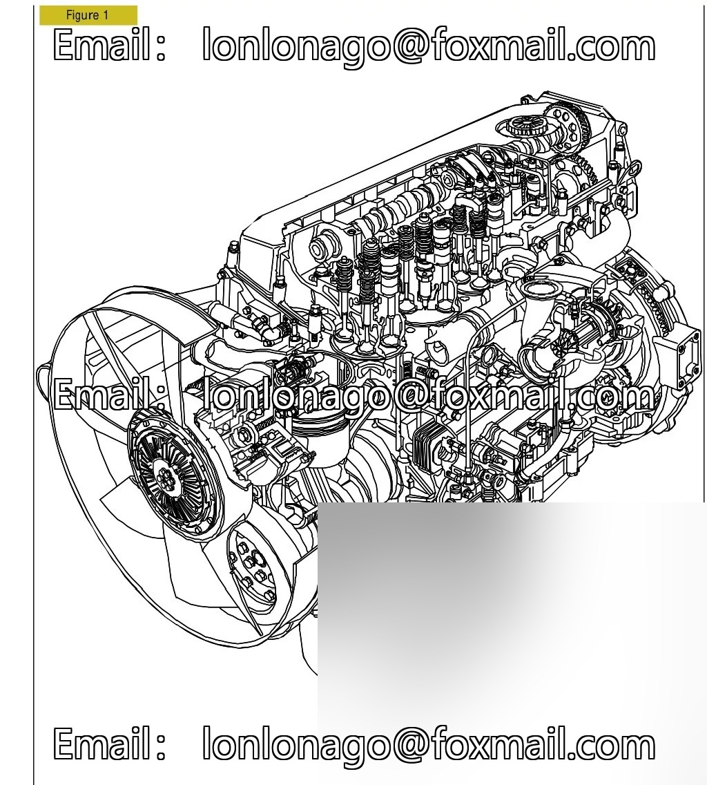
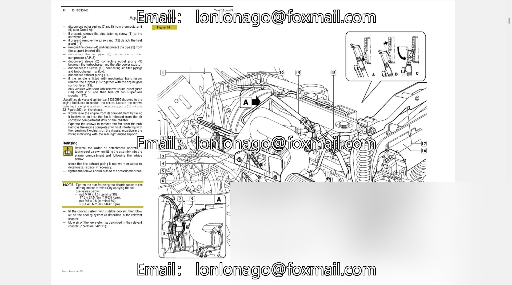
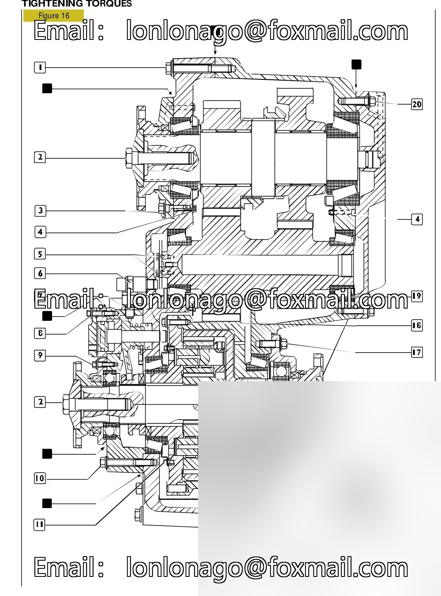
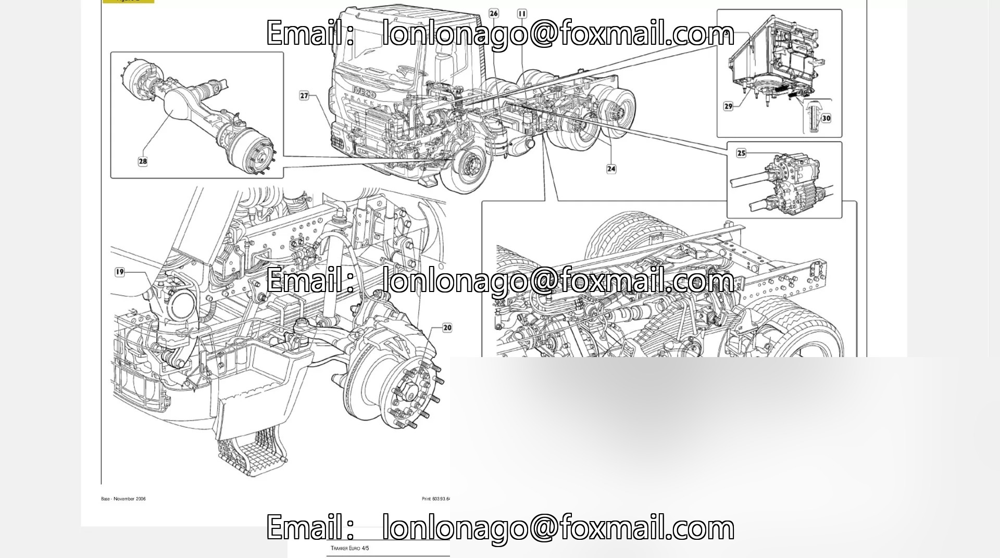

# IVECO TRAKKER EURO 4/5 Repair Manual

## Body

IVECO TRACKER EURO 4/5 Maintenance Manual
The contents cover repair guidelines for mechanical and electrical/digital systems

PDF 1,400 pages.
Suitable for use of vehicles with IVECO TRAKKER series European 4/5 emission standards, for reference of professional technicians or technical personnel.
non-refundable upon sale.
242652163

The manual covers mechanical and electrical/electronic system repair guidance, with 1,400 pages of content; it is suitable forIVECO TRAKKER series Euro4/Euro5 emission-standard vehicles, intended for professional technicians or technical staff, and is sold without returns.

<!-- AI_ENRICHED -->

## Images

## Payment

Here is a pay link on Stripe ( https://buy.stripe.com/3cs8yP7sY87d0vu9AB ). Please contact me lonlonago@foxmail.com after funding $89, and I will send you a complete data files , thank you!

